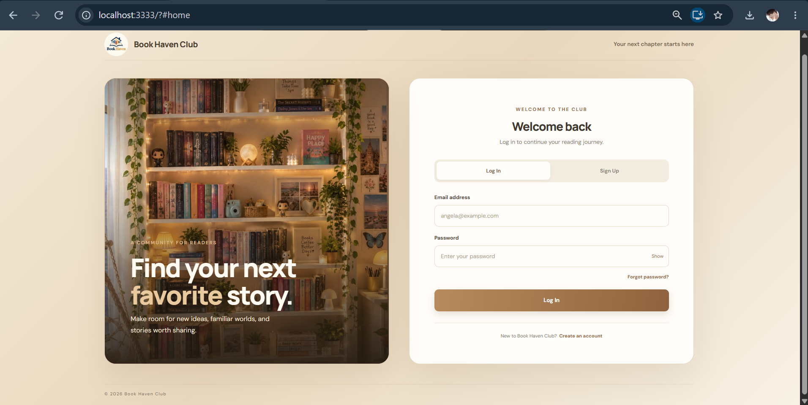
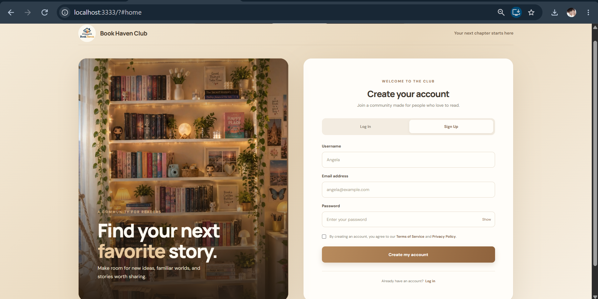

# Project React — Login & Registration

This project was bootstrapped with [Create React App](https://github.com/facebook/create-react-app).

## Overview

A responsive login and Registration page built using React and TypeScript.

## Technologies Used

- React
- TypeScript
- Create React App
- CSS
- Yarn

## Screenshots

### Login Page

### Registration Page

## Installation

1. Clone the repository:

   git clone YOUR_REPOSITORY_URL

2. Navigate into the project:

   cd project-react

3. Install the dependencies:

   yarn install

4. Start the application:

   yarn start

5. Open the following address in your browser:

   http://localhost:3333

## Port Configuration

The development server is configured to use port 3333.

## Notes

This is a frontend demonstration project.
It does not implement real authentication or connect to a backend.

## Learn More

You can learn more in the [Create React App documentation](https://facebook.github.io/create-react-app/docs/getting-started).

To learn React, check out the [React documentation](https://reactjs.org/).
